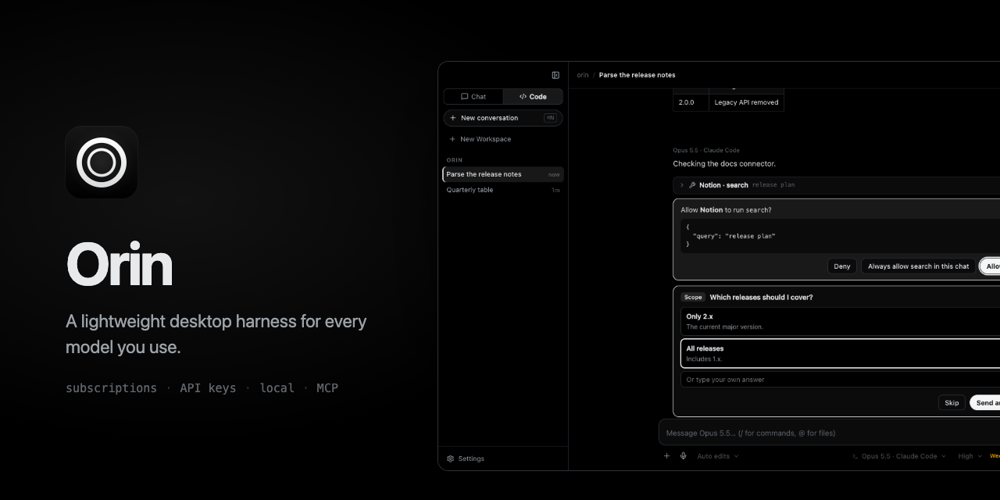

<p align="center"></p>

# Hanobi

Hanobi is a lightweight desktop harness for the language models you use. One window connects to three types of model source:

| Route | How it connects | Examples |
| --- | --- | --- |
| Subscription | Runs the official CLI with your existing sign-in. Hanobi never reads CLI tokens. | Claude Code (Claude Pro/Max), Codex (ChatGPT), GitHub Copilot, Gemini CLI |
| API key | Calls the provider API. Keys are encrypted with the macOS Keychain. | Anthropic, OpenAI, Google Gemini, OpenRouter, DeepSeek, Mistral, Groq, xAI Grok, GitHub Models, any OpenAI-compatible URL |
| Local | Calls a model server on this Mac. No key, no network. | Ollama, LM Studio |

Hanobi runs on macOS 12 Monterey and later, including Intel Macs. It pins Electron 40.3.0 to keep macOS 12 support.

## Features

- **Chat** and **Code** views. Code lists the folders you add with **New Workspace**. Chat lists general chats and **Projects**.
- Projects: instructions and documents that every chat in the project gets. API and local models receive the instructions and the document text in the system prompt. Hanobi converts PDF, Word (`.docx`, `.doc`), RTF, OpenDocument, PowerPoint (`.pptx`), and Excel (`.xlsx`) documents to text with macOS tools. Scanned PDFs and images have no text, so the model gets only their names. CLI agents run in the project folder with read-only tools, read the instructions from `CLAUDE.md`, `AGENTS.md`, and `GEMINI.md`, and open any document themselves.
- Chats use the same model sources as code. Subscription chat apps (claude.ai, ChatGPT, Gemini) have no public API for other apps, so chats with a subscription go through its CLI with read-only tools.
- A model picker for every connected model. You can switch models in the middle of a conversation. A model from the same provider continues with the full native history. A model from a different provider gets a text transcript.
- Streaming Markdown replies, thought summaries, and expandable tool calls.
- MCP connectors over stdio or Streamable HTTP, including OAuth sign-in (for example, Notion). API and local models ask before each tool call, unless you choose **Allow tools**. Claude Code receives the connectors that do not use OAuth.
- Image attachments for API and local models.
- Branching: start a new branch from any of your messages, then edit and send it again.
- Rewind: return to before any of your messages. Rewind the conversation, the workspace files, or both. Before each turn in a Git workspace, Hanobi saves a checkpoint of every file that `.gitignore` does not exclude. It uses a private index, so your index, branches, and stash do not change. Git can delete checkpoints older than two weeks.
- Suggested replies under the latest reply. Claude Code makes them. API and local models make them when you turn on **Settings → General → Suggested replies** (one extra request per reply).
- Questions: the model can ask you multiple-choice questions during a turn. Claude Code (AskUserQuestion), Codex in **Ask first**, and API and local models (a `hanobi__ask_user` tool) support them.
- Files in and out of conversations:
  - Attach any file with **+**, drag and drop, or paste. Hanobi copies it into the conversation. Text from PDF, Word, RTF, OpenDocument, PowerPoint, Excel, CSV, and text files goes to every model. API models get images as images. CLI agents also get each file's path.
  - Code blocks have their own bar: the language or file name, **Preview** for HTML, SVG, Markdown, and CSV, **Download** as a file with the right extension, and **Copy**.
  - **Run** opens an HTML snippet or HTML file with JavaScript on, in its own window. That window has its own in-memory session, no Node.js, and no access to Hanobi, your files, or your keys. Permission requests (camera, microphone, location) are denied. It can load from the internet, so CDN libraries work. The inline **Preview** keeps scripts off.
  - API and local models can make files with the `hanobi__write_file` tool: text formats, `.html`, `.docx`, `.rtf`, `.odt`, and `.pdf`.
  - File cards show files you attach, files the model makes, and files a CLI agent writes. Each card has **Preview** (Quick Look), **Copy** (text, image, or the file itself), **Download**, **Open with default app**, and **Show in Finder**.
  - **Download** on a reply saves it as Markdown, Word, or PDF.
- Voice input: click the microphone to start and click again to stop, or hold it to talk and release to stop. **⌘⇧D** works the same way, and Esc cancels. The text goes into the composer, so you can check it before you send. Whisper runs on this Mac (WebAssembly), so audio never leaves it. The first use downloads the model once from Hugging Face: Tiny (45 MB, the default on Intel Macs), Base (80 MB, the default on Apple Silicon), or Small (250 MB). Choose the model and the language you speak in **Settings → General**. macOS asks once for microphone access.
- Desktop app:
  - Notifications, a Dock badge, and a Dock bounce when a reply finishes or needs your approval while Hanobi is in the background. Click a notification to open the conversation.
  - **⌥ Space** shows Hanobi from any app and hides it again. Change or turn off the shortcut in **Settings → General**.
  - Open at login, one Hanobi at a time, the window size and place from last time, and a Dock menu with New Conversation and New Window.
  - A free daily check of GitHub Releases for a newer version. Hanobi links to the release; it does not install it.
- Git panel: status, diffs, stage, unstage, and commit. Switch or create branches, see commits to push and pull, push, publish a new branch, and pull (fast-forward only).
- GitHub pull requests through the GitHub CLI (`gh`): the pull request of the current branch with its state, review decision, and checks; create one (title, Markdown description, base branch, draft); list open pull requests, open them on GitHub, or check them out. Run `gh auth login` once. Hanobi stores no GitHub token.
- A list of the skills that your CLI agents load.
- Light and dark modes that follow macOS. Theme palettes: Hanobi, Gemini style, ChatGPT style, DeepSeek style, and a custom accent color.
- A **…** menu on each conversation in the sidebar: Rename, Open in split pane, Pin to top, Move to project or workspace, and Delete.
- Split panes: up to four conversations side by side, each with its own model. Drag a divider to resize; double-click it to make the panes equal (`⌘D` opens a new pane).
- Drag a conversation in the sidebar to change its place in the list (or press `⌥↑` / `⌥↓` on a selected row). A moved list keeps its order; new conversations appear on top.
- Focus mode (`⇧⌘F`): one conversation edge to edge in full screen, in a terminal layout: monospace text, prompt and reply both left to right. `Esc` leaves focus mode and keeps full screen.
- Context usage ring next to the model: how full the model's context was after the last reply, for every model that reports tokens. Claude Code, Codex, and Copilot report the context size; for API models the size comes from a table (Claude) or is unknown.
- Message actions on hover: Copy, Edit, Rewind, and Branch. Edit replaces the message and the replies after it.
- Multiple windows and keyboard shortcuts (`⌘N`, `⌘D`, `⇧⌘F`, `⌘,`, `⌘\`).

## Install

```sh
npm install
npm run install:mac
```

This builds Hanobi and puts it in `/Applications`. Open it from Spotlight, Launchpad, or the Dock like any other app. To update, run `git pull`, then `npm run install:mac` again. Your conversations and settings stay. The app is free and has no Apple developer signature, so macOS may ask once for Keychain access to Hanobi's saved keys. Click **Always Allow**.

For development, `npm start` runs Hanobi from the source folder with the same data.

## Run

Then open **Settings → Models**:

- **Subscriptions:** install a CLI (for example, `claude`) and sign in from Terminal. Hanobi finds it automatically. Click the rescan button after you install one.
- **API keys:** click **Add a provider**, choose a provider, and paste a key.
- **Local:** start Ollama or LM Studio, then add it. Hanobi lists the downloaded models.

GitHub Copilot needs its CLI: run `npm install -g @github/copilot`. It uses your GitHub sign-in (`gh auth login`). Each turn uses premium requests from your Copilot plan. Copilot loads its own MCP servers from `~/.copilot/mcp-config.json`.

Microsoft Copilot (the consumer app) has no API for other apps, so Hanobi cannot connect to it. Microsoft 365 Copilot has a preview Chat API, but only for work accounts with a Microsoft 365 Copilot license.

Gemini CLI does not serve personal Google AI plans now. Those accounts moved to Antigravity. To use Gemini with a personal account, add a **Google Gemini API** key.

## Access modes

| Mode | CLI agents | API and local models |
| --- | --- | --- |
| CLI rules | The CLI's saved permission rules. Requests that need an interactive prompt are denied. | n/a |
| Read only | Plan mode or read-only sandbox | n/a |
| Auto edits (default for CLIs) | File edits allowed. Other actions follow the CLI. | n/a |
| Ask first (default for APIs) | Claude Code, Codex, and GitHub Copilot. Hanobi shows each permission prompt of the CLI, with Allow once, Always allow in this chat, and Deny. Codex runs in the workspace-write sandbox and asks before untrusted commands. Copilot runs as an ACP server (`copilot --acp`) with allow-all off. | Hanobi asks before each MCP tool call |
| Full access / Allow tools | No approval and no sandbox. Hanobi asks you to confirm first. | Tools run without asking |

## Privacy and security

- Conversations are stored in `~/Library/Application Support/Hanobi/hanobi-data.json` with user-only file permissions.
- API keys, MCP environment values, headers, and OAuth tokens are stored in `hanobi-secrets.json`. Electron `safeStorage` encrypts them with the macOS Keychain. The renderer never receives these values.
- Prompts go only to the model you choose and to the MCP servers that you turn on.
- The renderer runs sandboxed with context isolation and a strict Content Security Policy. Links open in your browser.

## Development

```sh
npm test            # unit and end-to-end tests (fake model servers, a real MCP server)
npm run smoke       # starts the real app with throwaway data and drives the UI
npm run icons       # renders build/icon.icns and docs/cover.png from their sources
npm run package:mac # DMG and ZIP in dist/release; unsigned when no Developer ID certificate is installed
npm run package:mac:release # signed and notarized; fails without a certificate
npm run install:mac # build and install in /Applications
```

`SMOKE_SHOTS=<folder> npm run smoke` saves light and dark screenshots. See [docs/ARCHITECTURE.md](docs/ARCHITECTURE.md) for how the parts fit together.

The packaged app is unsigned for now. macOS may ask you to allow it in **System Settings → Privacy & Security**. [docs/RELEASING.md](docs/RELEASING.md) tells you how to sign, notarize, and publish a release.

## Contributing

Read [CONTRIBUTING.md](CONTRIBUTING.md) for setup, rules, and tests.

## Roadmap

1. Live verification of each API provider on real accounts.

## License

[MIT](LICENSE)
